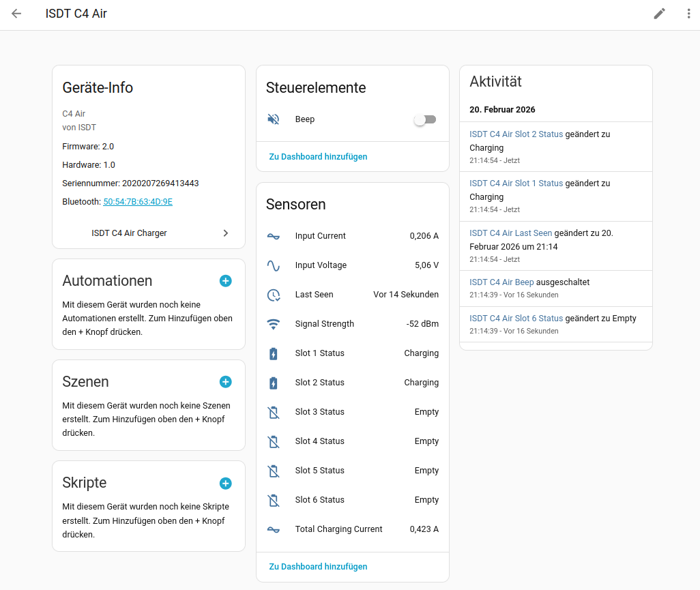
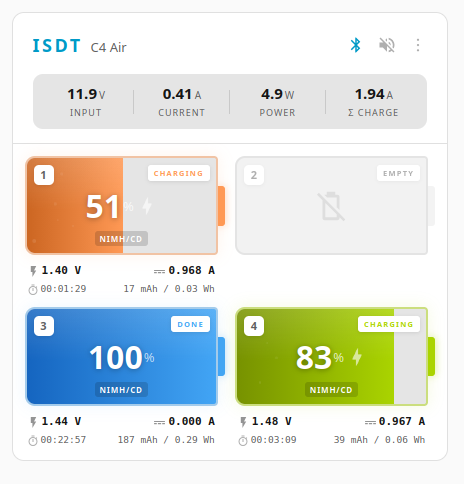
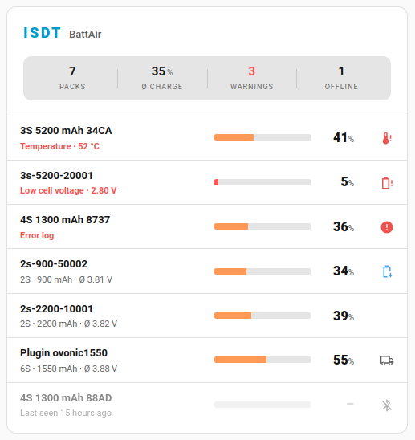
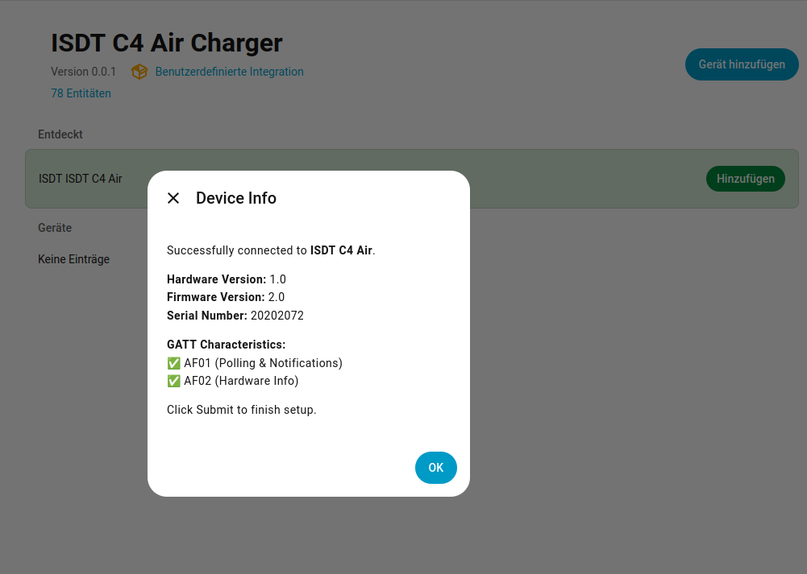
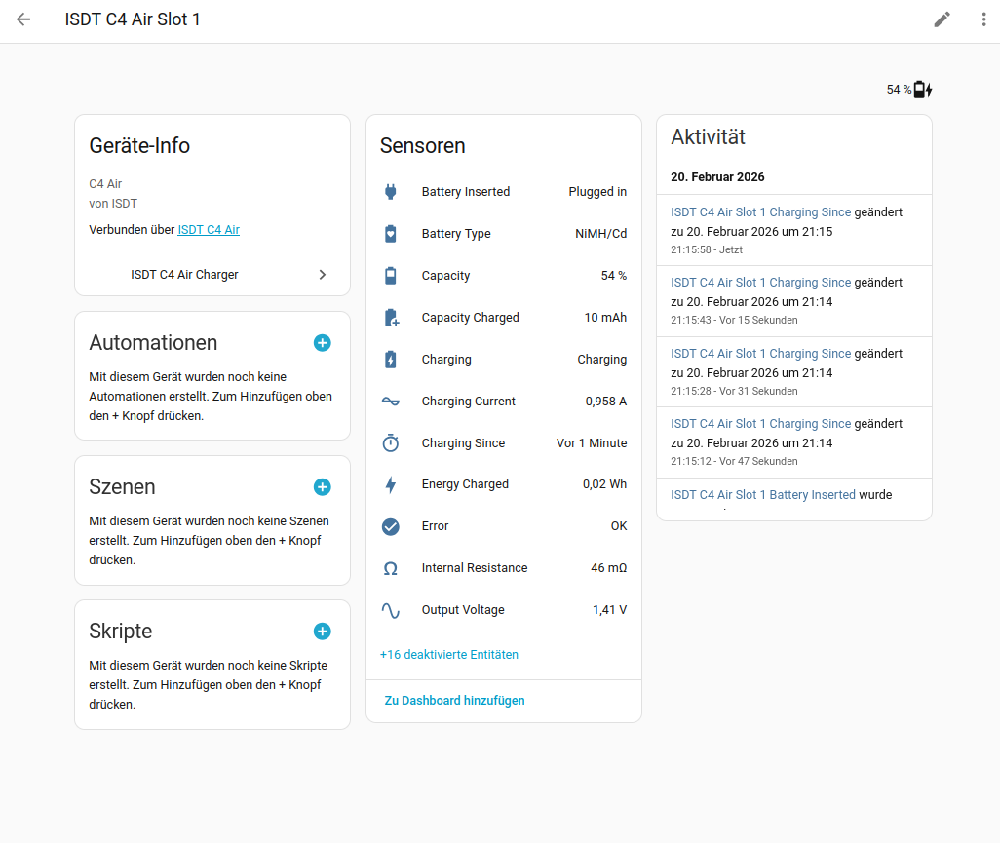

# ISDT Air BLE – Home Assistant Integration

[](https://www.home-assistant.io/integrations/marketplace/)
[](https://github.com/mtheli/isdt_air_ble/releases)
[](LICENSE)

Custom Home Assistant integration for **ISDT chargers** and the **MASS2** USB power adapter with Bluetooth Low Energy (BLE) connectivity. Communicates directly with the device via a persistent BLE connection — no cloud, no app required.

Supports the **C4 Air** (6-channel charger), **A8 Air** (8-channel charger), **Air 8** (1S–8S LiPo balance charger), and **MASS2** (8-port USB adapter). **BattAir** smart packs and plugins are read from their Bluetooth broadcasts, without a connection (beta).



---

## Table of Contents

- [Lovelace Card](#lovelace-card)
- [Tested Models](#tested-models)
- [Features](#features)
  - [Chargers (C4 Air, A8 Air)](#chargers-c4-air-a8-air)
  - [MASS2 USB Adapter](#mass2-usb-adapter)
  - [BattAir packs and plugins](#battair-packs-and-plugins)
- [Screenshots](#screenshots)
- [Installation](#installation)
- [Setup](#setup)
- [Configuration](#configuration)
- [Blueprints](#blueprints)
  - [Charging Completion](#charging-completion)
- [BLE Protocol](#ble-protocol)
- [Related Projects](#related-projects)

---

## Lovelace Card

A dashboard card, the **ISDT Charger Card**, ships with this integration: battery-style slots with live charge timer, connection indicator, and full HA theme support. No separate installation and no dashboard resource setup needed. The integration registers the card itself (you'll see one entry under *Settings → Dashboards → Resources*, which it keeps up to date). Add it via the dashboard card picker or in YAML:

```yaml
type: custom:isdt-charger-card
device_id: <your-device-id>
```



### BattAir card

A second card, `custom:isdt-battair-card`, lists all BattAir packs and plugins on one card, one line per pack. Packs with a problem (error log, low cell voltage, temperature below 5 °C or above 45 °C) move to the top with the problem in red; storage discharge and transport mode show as icons. Packs that are out of range stay in the list with the time they were last seen. It finds the packs by itself, no configuration needed: add **ISDT BattAir Card** from the dashboard card picker (it is also suggested when you add a card for a BattAir entity), or in YAML:

```yaml
type: custom:isdt-battair-card
# optional:
title: Flight packs
sort: name            # name | charge | last_seen
hide_unavailable: false
show_cycles: false
```



> **Upgrading from the standalone card?** The card was previously installed separately from [isdt_air_card](https://github.com/mtheli/isdt_air_card). If that copy is still installed, remove it: remove *ISDT Charger Card* in the Marketplace (in HACS before Home Assistant 2026.11; this also removes the dashboard resource), or delete the manually added resource under *Settings → Dashboards → Resources*. A leftover standalone copy can shadow the bundled, up-to-date card; the integration raises a repair issue if it finds one. Your dashboards keep working unchanged, the card type stays `custom:isdt-charger-card`. Card development continues in that repository; releases ship here.

## Tested Models

| Model | Bluetooth | Tested by |
| :--- | :---: | :--- |
| **Round-cell chargers** | | |
| [C4 Air](https://www.isdt.co/c4air.html?lang=en) (6 slots) | :white_check_mark: | Maintainer |
| [A8 Air](https://www.isdt.co/a8-air.html?lang=en) (8 slots) | :white_check_mark: | Community ([#1](https://github.com/mtheli/isdt_air_ble/issues/1), [#4](https://github.com/mtheli/isdt_air_ble/issues/4)) |
| **Camera battery chargers** | | |
| [NP2 Air](https://www.isdt.co/np2air.html?lang=en) (2 slots, Sony NP-FZ100 / NP-FW50 / NP-BX1) | :white_check_mark: | Community ([#12](https://github.com/mtheli/isdt_air_ble/issues/12), [#13](https://github.com/mtheli/isdt_air_ble/issues/13)) |
| [LP2 Air](https://www.isdt.co/lp2air.html?lang=en) (2 slots, Canon LP-E6 / LP-E12 / LP-E17) | *not yet tested* | — |
| **LiPo balance chargers** | | |
| [Air 8](https://www.isdt.co/air8.html?lang=en) (1S–8S, single channel) | :white_check_mark: | Community ([#2](https://github.com/mtheli/isdt_air_ble/issues/2)) |
| [K2 Air](https://www.isdt.co/k2air.html?lang=en) (2 × 1S–6S) | :white_check_mark: | Community ([#3](https://github.com/mtheli/isdt_air_ble/issues/3)) |
| [K4](https://www.isdt.co/k4.html?lang=en) (2 × 1S–8S) | *not yet tested* | In progress ([#11](https://github.com/mtheli/isdt_air_ble/issues/11)) |
| [608PD](https://www.isdt.co/608pd.html?lang=en) | *not yet tested* | — |
| **USB power adapters** | | |
| [MASS2](https://www.isdt.co/mass2.html?lang=en) (8 USB ports) | :white_check_mark: | Maintainer |
| [Power 200 / 200H / 200X](https://www.isdt.co/power200.html?lang=en) (wireless pad + 4 USB ports) | :white_check_mark: | Community ([#5](https://github.com/mtheli/isdt_air_ble/issues/5), 200H) |
| **Smart battery packs** | | |
| BattAir packs and BattAir Plugin (BAP2/4/6) | :white_check_mark: (beta) | Community ([#15](https://github.com/mtheli/isdt_air_ble/issues/15), captures) |

Other BLE-enabled ISDT devices using the same protocol may also work. The integration auto-detects the model from the Bluetooth advertisement and creates one sub-device per slot or port (6 for the C4 Air, 8 for the A8 Air, 2 for the NP2 Air, 1 pack with per-cell voltages for the Air 8, 8 USB ports for the MASS2), with only the entities the model supports. If your model works, please [let me know](https://github.com/mtheli/isdt_air_ble/issues) so I can add it to the list!

---

## Features

- **Auto-discovery** via Bluetooth — the device appears automatically in Home Assistant
- **One-time pairing** — the bind UUID is stored in the config entry, so the device recognises Home Assistant across restarts (no repeated button presses)
- **Persistent BLE connection** with automatic reconnect
- **Slot / port sub-devices** with detailed per-slot or per-port sensors (6 slots for chargers, 8 USB ports for MASS2)
- **Live charge timer** (chargers) using timestamp-based tracking — updates in real-time in the frontend
- **Hardware info** — firmware version, hardware version, serial number (where the charger sends one) in the device registry
- **Configurable poll interval** (3–300 seconds) via options flow

### Chargers (C4 Air, A8 Air)

**Main device:**

| Sensor | Type | Description |
|--------|------|-------------|
| Connected | Binary (Connectivity) | BLE connection active |
| Input Voltage | Voltage (V) | Power supply voltage |
| Input Current | Current (A) | Total input current |
| Total Charging Current | Current (A) | Sum of all slot currents |
| Slot 1–6/1–8 Status | Enum | `empty`, `idle`, `charging`, `done`, `error` (6 slots for C4 Air, 8 slots for A8 Air) |
| Signal Strength | RSSI (dBm) | BLE signal strength (disabled by default) |
| Beep | Switch | Toggle the charger alarm/beep tone (C4 Air only) |

**Per slot (sub-device):**

| Sensor | Type | Description |
|--------|------|-------------|
| Charging | Binary (Charging) | Whether the slot is actively charging |
| Battery Inserted | Binary (Plug) | Whether a battery is present in the slot |
| Error | Binary (Problem) | Whether the slot has a charging error |
| Output Voltage | Voltage (V) | Slot output voltage |
| Charging Current | Current (A) | Slot charging current |
| Capacity | Battery (%) | Current charge level (hidden when no battery inserted) |
| Capacity Charged | mAh | Charged capacity in current session |
| Energy Charged | Energy (Wh) | Charged energy in current session |
| Charging Since | Timestamp | Charge start time (live-updating) |
| Battery Type | Text | Detected chemistry (LiPo, NiMH, LiFe, etc.) |
| Internal Resistance | mOhm | Battery internal resistance |
| Cell 1–16 Voltage | Voltage (V) | Individual cell voltages (C4 Air only, disabled by default) |
| Charge Current Setting | Current (A), diagnostic | Charge current set for the slot, as the charger reports it; 0 = automatic (C4 Air only) |
| Cut-off Setting | mV, diagnostic | Full-charge cut-off set for the slot, raw (the -dV delta for NiMH/NiCd); 0 = default for the chemistry (C4 Air only) |
| Capacity Limit Setting | mAh, diagnostic | Capacity limit set for the slot, 0 = no limit (C4 Air only) |

The three setting sensors show the charge settings the charger stores per slot, read from the slot's work state. They
are read-only.

### MASS2 USB Adapter

**Main device:**

| Entity | Type | Description |
|--------|------|-------------|
| Connected | Binary (Connectivity) | BLE connection active |
| Total Power | Power (W) | Sum of all port power draw |
| USB-C1…C6 / USB-A1–A2 Status | Enum | `off`, `idle`, `active` |
| Signal Strength | RSSI (dBm) | BLE signal strength (disabled by default) |
| Beep | Switch | Toggle the buzzer for USB events |
| Volume | Select | Buzzer volume — low / medium / high |

**Per USB port (sub-device):**

| Sensor | Type | Description |
|--------|------|-------------|
| Active | Binary (Power) | Whether the port is delivering power |
| Voltage | Voltage (V) | Output voltage |
| Current | Current (A) | Output current |
| Power | Power (W) | Current power draw |
| Protocol | Enum | Charging protocol (`None`, `USB PD`, `Fast Charge`) |

### BattAir packs and plugins

BattAir packs and plugins are not paired and not connected. Each one appears under **Discovered** and is set up with a single confirmation; all values come from the broadcast the pack sends about once a second (measurements refresh about once a minute). A pack that has not been heard for 15 to 20 minutes goes unavailable, *Last seen* keeps the time it was last heard.

| Entity | Type | Description |
|--------|------|-------------|
| Voltage | Voltage (V) | Pack voltage |
| Average cell voltage | Voltage (V) | Pack voltage divided by the number of cells |
| Charge level | Battery (%) | Charge level as the pack reports it |
| Temperature | Temperature (°C) | Pack temperature |
| Cycles | Count | Charge cycles |
| Low average cell voltage | Binary (Problem) | Average cell voltage below 3.0 V (LiPo, LiHV and LiUHV packs) |
| Error log | Binary (Problem) | The pack has logged errors (over-temperature, over-voltage, over-discharge) |
| Storage discharge | Binary | The pack is discharging itself to storage voltage |
| Transport mode | Binary, diagnostic | Transport mode is on |
| Cells, Capacity, Battery type | diagnostic | Pack configuration |
| Last seen | Timestamp, diagnostic | Time of the last broadcast |
| Signal strength | RSSI (dBm), diagnostic | Disabled by default |

Individual cell voltages are not in the broadcast and are not available.

## Screenshots

| Config Flow | Device Overview | Slot Detail |
|:-----------:|:---------------:|:-----------:|
|  |  |  |

## Installation

### Marketplace (recommended)

This integration is listed in the Home Assistant **Marketplace**. Click the button below, or go to **Settings → Marketplace** and search for "ISDT". Select **Install** and the setup starts right away, no restart needed.

[](https://my.home-assistant.io/redirect/marketplace_repository/?owner=mtheli&repository=isdt_air_ble&category=integration)

Requires Home Assistant 2025.1 or newer. On Home Assistant before 2026.11, the button opens the repository in [HACS](https://hacs.xyz/docs/use/) instead. Download it there and restart Home Assistant.

<details>
<summary>Manual installation</summary>

1. Copy the `custom_components/isdt_air_ble` folder into your Home Assistant `config/custom_components/` directory
2. Restart Home Assistant

</details>

## Setup

1. Make sure your Home Assistant has a Bluetooth adapter (built-in or USB)
2. Power on your ISDT device
3. It should be auto-discovered — check **Settings → Devices & Services → Discovered**
4. Click **Configure** and follow the pairing prompt — press any button on the device within 30 seconds to confirm pairing (the MASS2 will beep, chargers wait silently). After the first pairing, subsequent reconnects are silent.

## Configuration

After setup, you can adjust the **command interval** via the integration options:

1. Go to **Settings → Devices & Services**
2. Find the ISDT device entry
3. Click **Configure**
4. Set the command interval (default: 100 ms, range: 100–1000)

The command interval is the pause between two Bluetooth commands while polling. Raise it if charger values drop out every few seconds: on a weaker link some chargers skip commands that arrive too close together. Readings then update less often.

## Blueprints

Optional Home Assistant automation blueprints for common use cases. They are
not installed with the integration through the Marketplace; import each one separately
into Home Assistant.

### Charging Completion

Runs user-defined actions when an ISDT charging session has ended.
Contributed by [@agarthand](https://github.com/agarthand) in
[#9](https://github.com/mtheli/isdt_air_ble/pull/9).

The blueprint uses the charger's **Total Charging Current** sensor instead of
individual slot status sensors. This avoids false completion detection caused
by temporary `unknown` or `unavailable` slot states during Bluetooth
reconnections.

#### How it works

1. A charging session is detected when the total charging current remains above
   the configured start threshold.
2. The automation waits until the total charging current remains below the
   configured finish threshold.
3. The user-configured completion actions are executed.

Default values:

- Charging start: above `0.05 A` for 15 seconds
- Charging finish: below `0.01 A` for 1 minute
- Maximum session duration: 24 hours

The completion action is intentionally not predefined. Users can configure any
Home Assistant action, such as a mobile notification, text-to-speech
announcement, or light signal. Templates in these actions can use
`isdt_charging_current`, `isdt_charging_current_unit` and
`isdt_completion_time`.

A restart of Home Assistant while a session is running ends the wait, so no
completion action runs for that session.

#### Import

[](https://my.home-assistant.io/redirect/blueprint_import/?blueprint_url=https%3A%2F%2Fraw.githubusercontent.com%2Fmtheli%2Fisdt_air_ble%2Fmaster%2Fblueprints%2Fautomation%2Fcharging_complete.yaml)

Or import it manually using the following URL:

```text
https://raw.githubusercontent.com/mtheli/isdt_air_ble/master/blueprints/automation/charging_complete.yaml
```

## BLE Protocol

The integration communicates directly via BLE — no cloud, no account required. All communication is fully local.

Both chargers and the MASS2 adapter use a single GATT service with two characteristics:

- **AF01** – Data polling via continuous command cycling (charger: workstate, electric, IR, alarm tone; MASS2: port status, settings)
- **AF02** – Bind handshake and hardware info query (once after connect, before polling)

Chargers run a 19-command cycle (1 alarm-tone + 6 channels × 3 commands) at 100 ms intervals. The MASS2 uses a single WorkStatus poll per cycle. BLE notifications for the MASS2 are reassembled across fragments to handle the default 23-byte ATT MTU correctly.

For a detailed technical description of the BLE protocol including packet formats, command reference, and timing, see [PROTOCOL.md](PROTOCOL.md).

## Related Projects

- [ISDT Charge Utility](https://github.com/DittelHome/ISDT-Charge-Utility) by @DittelHome – standalone Windows/Linux app to monitor and control ISDT Air chargers (C4 Air, A4 Air, A8 Air), including setting charge parameters. Its [PROTOCOL.md](https://github.com/DittelHome/ISDT-Charge-Utility/blob/main/PROTOCOL.md) also documents the write commands.

## Disclaimer

This is an independent community project and is not affiliated with, endorsed by, or sponsored by ISDT. All product names, trademarks, and registered trademarks are property of their respective owners.

## License

[MIT](LICENSE)
